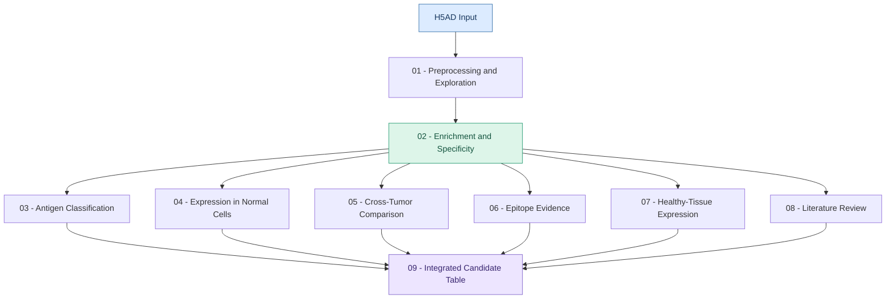

# Tumor Antigen Prioritization Pipeline

A modular Nextflow workflow for the identification, characterization, and prioritization of candidate tumor antigens using single-cell RNA-sequencing data.

---

## Overview

This project aims to identify and prioritize candidate tumor antigens by integrating malignant-cell expression specificity, cross-tumor expression patterns, healthy-tissue expression data, and immunological evidence.

The workflow is built with **Nextflow**, combining R and Python scripts into a modular and reproducible analytical pipeline.

## Objectives

- Explore and validate H5AD single-cell datasets.
- Identify genes enriched in malignant cells.
- Assess candidate expression in non-malignant populations and across tumor types (if the input is pan-cancer).
- Integrate epitope evidence and external data on expression enrichment in healthy tissues.
- Consolidate analytical results into an integrated candidate table for downstream evaluation.

## Workflow

## Input

- H5AD file containing single-cell gene expression data and cell annotations.

## Expected Outputs

- Dataset summaries and exploratory visualizations.
- Candidate gene tables and expression heatmaps.
- Cross-tumor expression comparisons (if the input is pan-cancer).
- Epitope evidence summaries.
- Healthy-tissue expression summaries.
- An integrated table of prioritized candidate tumor antigens.

## Technologies

| Technology | Purpose |
|---|---|
| Nextflow | Workflow orchestration |
| Python | Single-cell data processing and analysis |
| R | Statistical analysis and visualization |
| H5AD / AnnData | Single-cell data input and representation |

## Development Status

This project is under active development. Modules, parameters, dependencies, and execution instructions will be documented as the workflow evolves.

---

Research project in bioinformatics, single-cell transcriptomics, and cancer immunotherapy.

Laboratory of Bioinformatics, Artificial Intelligence, and Technological Innovation (LABIIT).

FEDERAL UNIVERSITY OF RIO GRANDE DO NORTE
